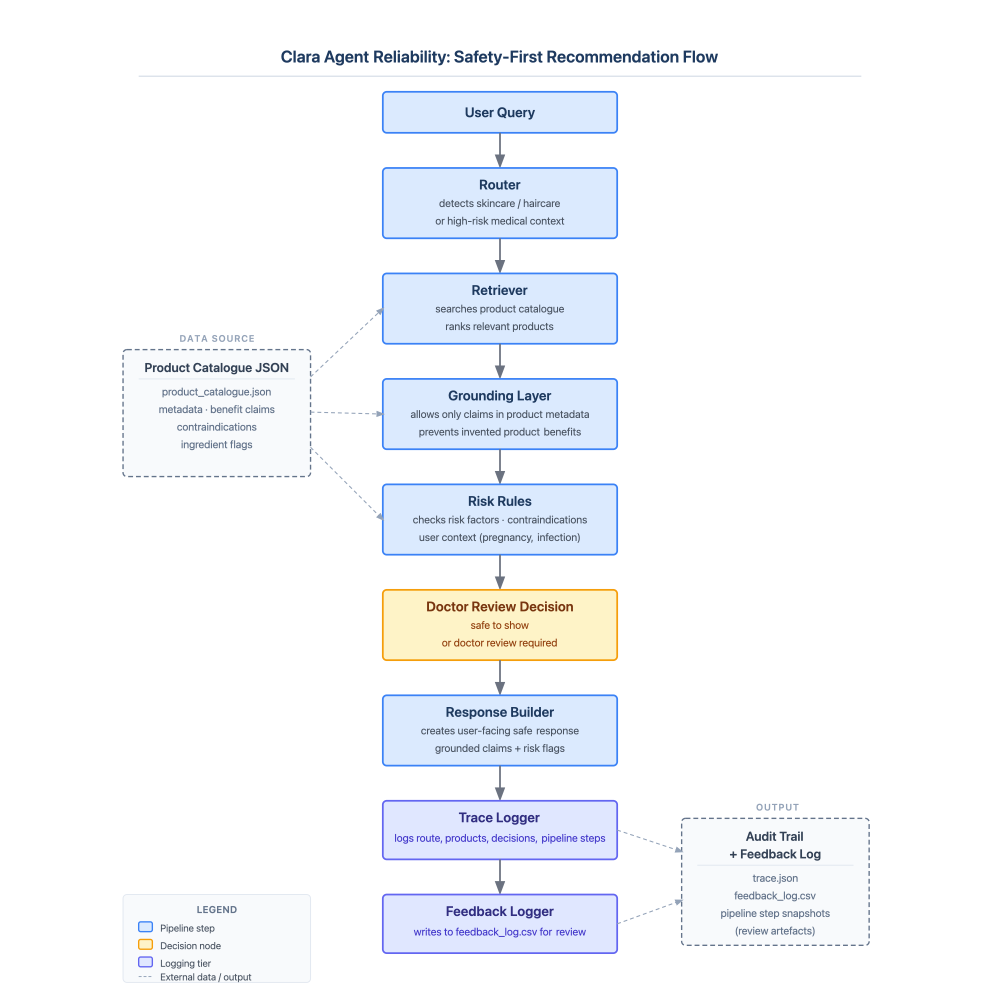
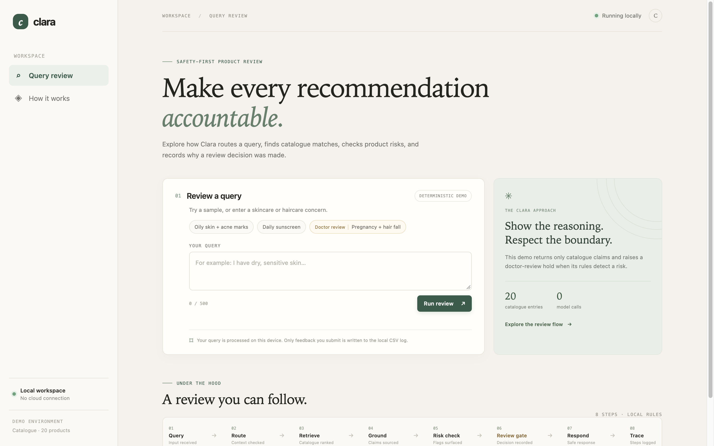
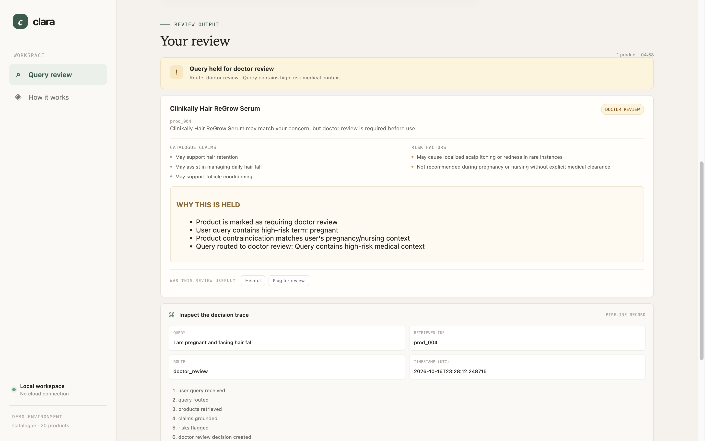
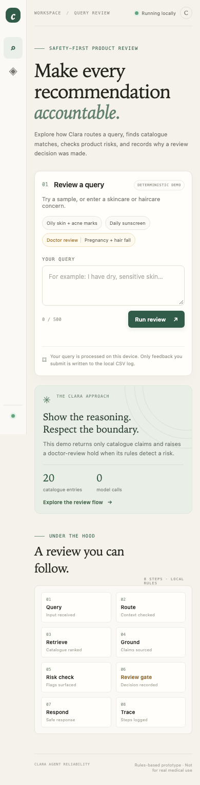

<div align="center">


# Clara Agent Reliability

**A local review workspace for safety gates in medical-adjacent product recommendations**

Enter a query in the local browser workspace. Clara routes it, searches the checked-in product catalogue, shows grounded claims and risk flags, and holds recommendations for doctor review when its rules require it.

[](https://github.com/ayushcodes13/clara-agent-reliability)
[](https://youtu.be/K3pfU-BcIXI)


</div>

---

## Why this project exists

A product can match a user's search terms and still be inappropriate for their context. For example, a pregnancy-related hair-loss query should not receive an ordinary product recommendation when the catalogue includes a pregnancy contraindication.

Clara demonstrates a rule-based control layer that routes queries, retrieves catalogue entries, exposes only catalogue claims, checks risk rules, and builds a review-gated response. It is a demonstration of those mechanisms, not a healthcare service.

## Architecture



The source illustration is also available as [`architecture.html`](architecture.html).

## Run the local review workspace

Requires Python 3.9 or later. No packages or build step are needed. Start the stdlib server from the repository root:

```bash
python3 -m src.web_app --host 127.0.0.1 --port 8765
```

Open [http://127.0.0.1:8765](http://127.0.0.1:8765). Choose a sample query or enter your own, then inspect the route, product claims, risk factors, review hold, and expandable decision trace. Feedback is optional; submitting it appends the query, product ID, selection, and optional note to the ignored local file `data/feedback_log.csv`.

The original command-line example remains available:

```bash
python3 demo.py
```

It prints three fixed examples and appends a sample feedback row to `data/feedback_log.csv` each time it runs.

## Screenshots

Captured from the running local UI. The mobile image was captured at a 390 × 844 CSS viewport using Playwright because Aside does not expose viewport resizing. Playwright CLI could not create its control socket on this FAT volume, so the installed Playwright runtime was used directly for that capture.

| Review workspace | Results and decision trace |
| --- | --- |
|  |  |

| Mobile workspace |
| --- |
|  |

Watch the [recorded demo](https://youtu.be/K3pfU-BcIXI). The architecture diagram and these screenshots complement the running local interface.

## Run the focused regression checks

```bash
python3 -m unittest test.test_safety_gate test.test_web_app
```

These checks cover the request-level doctor-review gate, local web endpoints, query validation, Host/Origin restrictions, security headers, and feedback writes through a mocked local logger. Older files in `test/` are print-based examples with import-time side effects, not an asserted full test suite; the focused command avoids those examples.

## What the demo demonstrates

- **Routing:** flags selected high-risk terms before retrieval.
- **Catalogue retrieval:** ranks products from a small local JSON file using keyword rules.
- **Grounded claims:** returns claims stored with each catalogue product.
- **Risk checks:** surfaces product risk factors and contraindications.
- **Review gate:** holds all returned recommendations when the query routes to doctor review, or when a product-specific rule requires it.
- **Trace:** returns route, retrieved product IDs, decisions, and pipeline steps with each result.
- **Feedback log:** optionally appends a submitted review row to a local CSV file.

## Limits and deployment

- This is a deterministic rules demo; it does not call a language model or use semantic retrieval.
- The catalogue is small, local, and manually maintained.
- Routing and risk checks rely on simple keyword rules and are not a substitute for clinical review.
- The browser interface is a local prototype with a small HTTP API; it has no clinician integration, live product database, accounts, or remote service.
- It is **not for real medical use**.
- Do not enter identifying or sensitive health information. Queries are processed by the local Python process and are not logged by the server. Feedback you explicitly submit is stored on disk in the local CSV.
- The interface has no authentication and is intended only for local use. The server refuses non-loopback bind addresses and checks local Host/Origin headers.
- The local browser interface has no Vercel Functions adapter and is not a hosted working demo.

## Static portfolio presentation

The [`site/`](site/) folder contains a static portfolio presentation built from the existing demo screenshots and project description. It is presentation-only: it does not accept or send queries or feedback. The query-review and feedback endpoints are available only when you run the Python server locally as described above. The screenshots show sample demo output and are not medical advice.

The static presentation has not been deployed. To serve it as a static Vercel project, use the repository root as the project root, choose the **Other** framework preset, leave the build command blank, and set the output directory to `site`. This publishes only the presentation files; it does not deploy the interactive Python service. Add a public URL here only after a deployment has been completed and checked.

## Possible next steps

- Build an evaluation set for routing and review decisions.
- Expand the catalogue and review product data sources.
- Add a review dashboard or API only with a clearly scoped, tested use case.

<div align="center">
  <sub>A small project for exploring reliability, traceability, and safety gates in recommendation workflows.</sub>
</div>
